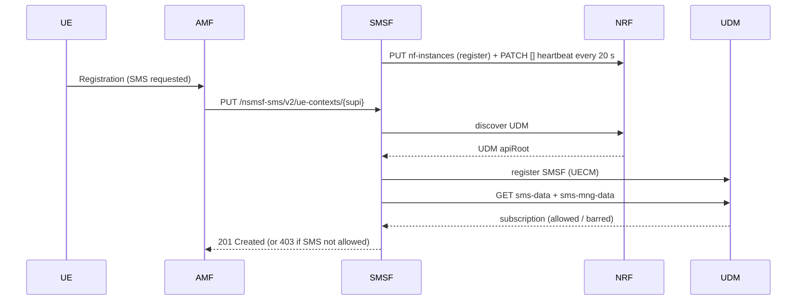
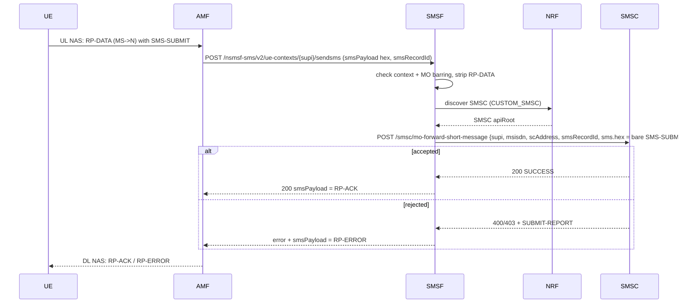
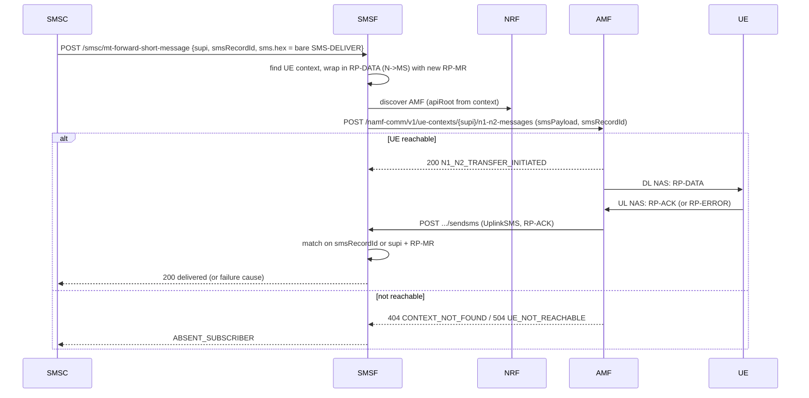

# SMS sequence diagrams (SMSF view)

Mermaid; renders on GitHub. RP layer (RP-DATA/ACK/ERROR) exists only UE <-> SMSF. SMSF <-> SMSC carries the bare TPDU.

## 1. Activation (UE registered, SMS service enabled)

## 2. MO SMS (UE -> SMSC)

## 3. MT SMS (SMSC -> UE)

## Test checklist (subscribers from UDM)

| Case | SUPI | Expected |
|---|---|---|
| MO ok | imsi-001010000000001 | RP-ACK |
| MO barred | imsi-001010000000005 | RP-ERROR |
| SMS not allowed | imsi-001010000000003 | activation refused |
| MT barred | imsi-001010000000004 | failure to SMSC |
| Unknown | imsi-001019999999999 | USER_NOT_FOUND |
